<div align="center">



<br />

<a href="https://github.com/TU_USUARIO"></a>
<a href="https://www.linkedin.com/in/TU_LINKEDIN"></a>
<a href="mailto:TU_CORREO"></a>

</div>

## `> sobre_mi`

```python
josias = {
    "enfoque":     ["automatización", "monitoreo", "IA aplicada"],
    "lenguaje":    "Python",
    "entornos":    ["Windows", "macOS"],
    "explorando":  ["agentes de IA", "modelos locales con Ollama", "n8n", "MCP"],
    "idiomas":     ["Español", "English"],
}
```

Construyo herramientas pequeñas y confiables que quitan trabajo manual: sistemas que vigilan métricas, avisan cuando algo se sale de lo normal y corren en segundo plano sin estorbar.

## `> stack`

<div align="center">


</div>

## `> proyectos`

| Proyecto | Qué hace | Tecnología |
| :-- | :-- | :-- |
| **Monitor de métricas** | Lee PostgreSQL, analiza métricas con pandas y lanza alertas flotantes con color y sonido. Compara contra la captura anterior y contra la misma hora de hace siete días. | Python · pandas · PostgreSQL |
| **Notificaciones broadcast** | Un servidor detecta condiciones y envía mensajes a PCs Windows remotas. Los clientes corren en segundo plano y se distribuyen con instalador. | Python · PyInstaller · Inno Setup |
| **CommunityLab** | Proyecto de equipo en el Hackathon ONE (Oracle Next Education + Alura): flujos orquestados con n8n y un LLM. | n8n · Gemini · Streamlit |

<!-- Agrega el enlace a cada repositorio cuando sea público: [**Nombre**](https://github.com/TU_USUARIO/repo) -->

<!-- ## `> actividad`

<div align="center">


</div>

<div align="center">
<sub><code>// construyo herramientas que trabajan solas</code></sub>
</div> -->
